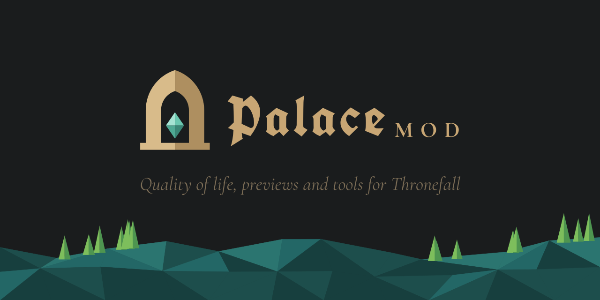

# PalaceMod brand

## The mark

A palace gateway in the game's gold, with a verdigris gem in the doorway. The stone is split into a lit left half and a
shaded right half, and the gem into four flat facets lit from the top left, echoing Thronefall's flat-shaded low-poly
models. The gold and the blackletter tie it to the game. The gem's cool verdigris is the one colour the game's UI never
uses, so it marks things as the mod's.

The gem on its own is the **emblem**: the mod's signature in-game. `ModStyle.AddEmblem` puts it beside every mod title,
button and notification.

| File | Use |
| --- | --- |
| `svg/mark.svg` | The mark, 48 px and up |
| `svg/mark-small.svg` | The 16-32 px cut: heavier stone, bigger gem. Favicons, the title-screen badge |
| `svg/emblem.svg` | The gem alone; the in-game signature |
| `svg/logo-dark.svg`, `svg/logo-light.svg` | Horizontal lockup for dark or light backgrounds |
| `svg/icon.svg` → `png/icon-256.png` | Thunderstore icon (256×256) |
| `svg/social-preview.svg` → `png/social-preview-1280x640.png` | GitHub social preview |

Everything is generated by `python3 branding/build.py` (needs `rsvg-convert` from `brew install librsvg`, and
`pip install fonttools`). It also writes the in-game textures `src/PalaceMod/Assets/palacemod_emblem.png`,
`palacemod_emblem_tint.png` (greys, for tinted emblems) and `palacemod_mark.png`. Edit the script, not the SVGs.

## Palette

| Role | Hex | Notes |
| --- | --- | --- |
| Charcoal | `#1A1C1D` | The game's panels; default background, the doorway |
| Gold | `#C8A674` | The game's text; wordmark on dark |
| Gold, lit | `#D8BB8A` | Left face of the stone |
| Gold, shaded | `#AE8F60` | Right face of the stone |
| Dim | `#7D6E57` | The game's secondary text; taglines |
| Bright | `#FFE7C4` | The game's highlighted text |
| **Verdigris** | `#6BC7B0` | **The signature (`ModStyle.Accent`)**: the gem, panel edges, rules |
| Verdigris, lit / shade / deep | `#A6E3D3` / `#4FA893` / `#3A8676` | The gem's other facets |
| Paper | `#F3EDE2` | Light background |
| Ink | `#4A3D2C` | Wordmark on light backgrounds (gold is too faint there) |
| World teals | `#173F3E` `#1D4E4C` `#236766` `#2B7570` | The game's grass; backdrops only |

On dark backgrounds use gold text; on light ones use ink. The mark itself works on both: its doorway is always filled
charcoal.

## Typography

The same faces as the game (both OFL, from Google Fonts):

- **UnifrakturCook Bold**: "Palace" in the wordmark, and titles. Sparingly, slightly tracked.
- **Cormorant Garamond Bold**, all caps, wide tracking (~0.3 em): "MOD", and section labels, like the game's
  "NIGHT:" and "SPAWNS:".
- **Cormorant Garamond Italic**: taglines and button-like text, like the game's menu entries.

In-game, take fonts from `ModStyle` (`TitleFont`, `BoldFont`, `BodyFont`, `ButtonFont`), never bundled copies.

## Rules

- Keep the mark's proportions and colours; don't recolour the gem, outline the mark, or add gradients, glows or
  shadows. Everything is flat fills.
- Below 48 px use `mark-small`; below 16 px use the emblem alone.
- Clear space around the mark: at least a quarter of its height.
- The wordmark is "Palace" + "MOD" as drawn; in running text write "PalaceMod".
- In-game, verdigris is only for things that say "this is the mod's" (emblem, panel edges, rules). Everything else uses
  the game's own palette, so mod UI looks native apart from its signature.
- No crowns: the crown is Thronefall's own mark.
